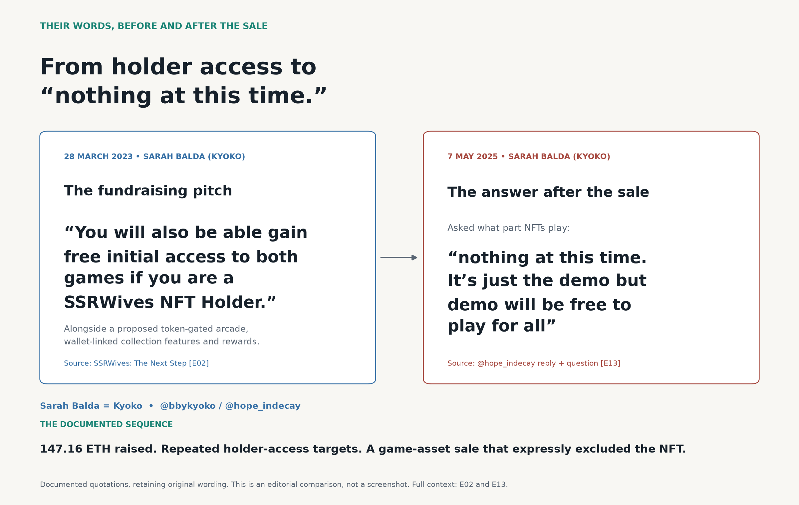
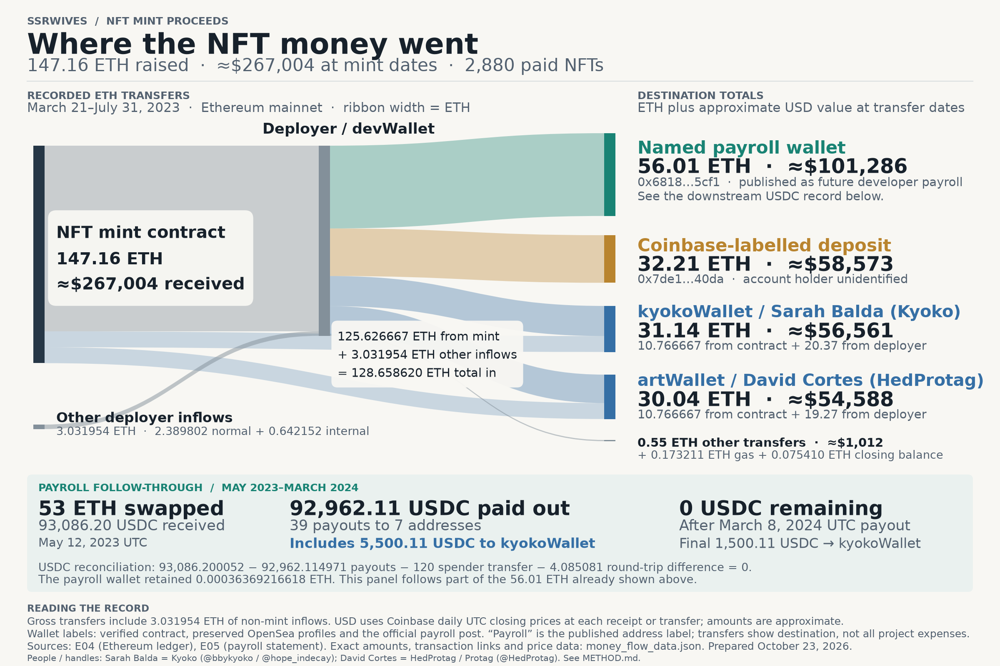
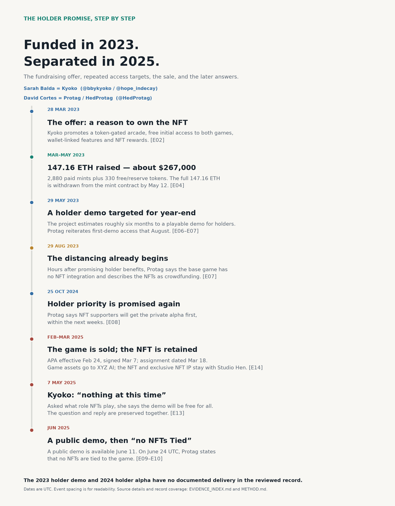
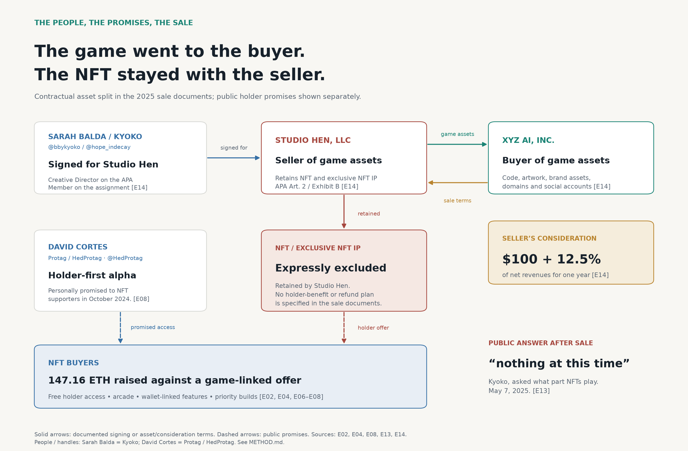
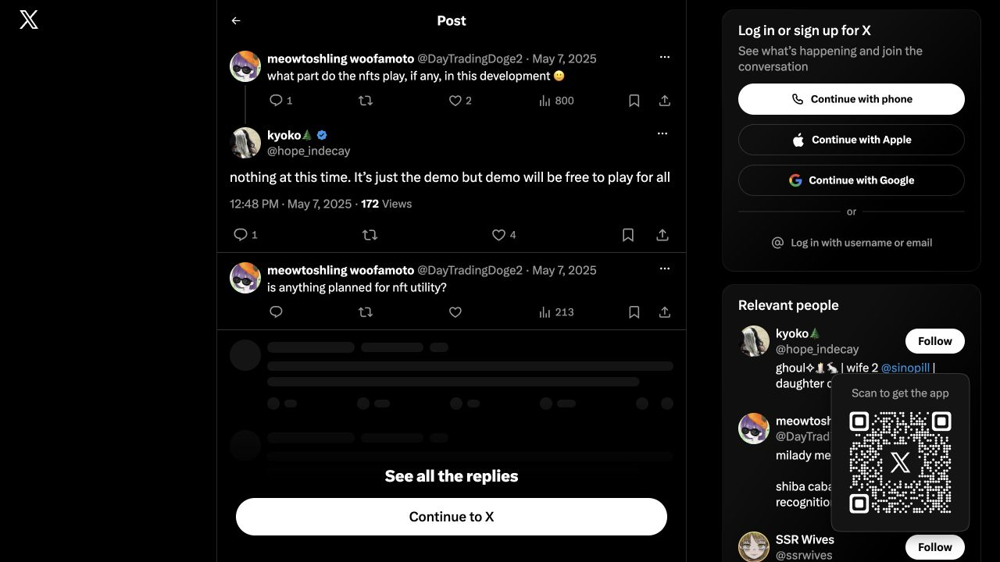
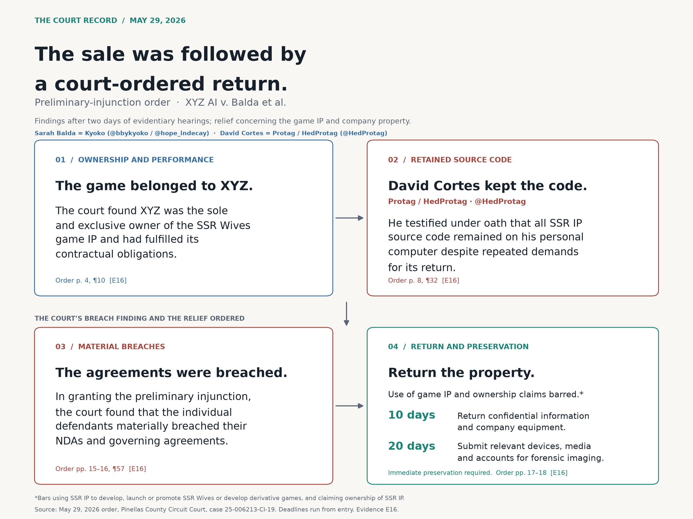

# $267,000 raised. A game sold. An NFT promise left behind.

## Executive summary

**SSRWives raised 147.16 ETH—approximately $267,000—with specific benefits offered to NFT holders.** The pitch included a token-gated arcade, free initial access, wallet-linked features and rewards. Holder-demo and alpha targets followed in 2023 and 2024. The reviewed archive contains no documented delivery of those holder builds, the arcade or the wallet-linked reward system. [E01](EVIDENCE_INDEX.md#e01) [E02](EVIDENCE_INDEX.md#e02) [E03](EVIDENCE_INDEX.md#e03) [E04](EVIDENCE_INDEX.md#e04) [E06](EVIDENCE_INDEX.md#e06) [E07](EVIDENCE_INDEX.md#e07) [E08](EVIDENCE_INDEX.md#e08) [E10](EVIDENCE_INDEX.md#e10)

**The game was sold; the NFT remained with the seller.** The 2025 agreement transferred the game assets to XYZ AI and expressly retained the NFT and its exclusive IP with the seller named as Studio Hen, represented by **Sarah Balda, known online as Kyoko (@bbykyoko, later @hope_indecay)**. It reserved $100 plus a one-year 12.5% net-revenue share for the seller, while specifying no holder-benefit, refund or replacement plan. Asked after the sale what role NFTs played, Kyoko answered: “nothing at this time.” [E13](EVIDENCE_INDEX.md#e13) [E14](EVIDENCE_INDEX.md#e14)

**The later dispute over the game produced a court finding of material breach.** On May 29, 2026, after two days of evidentiary hearings, a Florida court granted XYZ AI a preliminary injunction. The court found XYZ owned the game IP and had fulfilled its obligations. It recorded sworn testimony from **David Cortes, known online as HedProtag/Protag (@HedProtag),** that he retained all SSR IP source code on his personal computer despite repeated return demands. It found material breaches by the individual defendants, barred using that IP to develop, launch or promote the game, and ordered confidential information and equipment returned within ten days. [E16](EVIDENCE_INDEX.md#e16)

The central accountability question runs through the entire record: **buyers funded a holder-benefit promise, the seller retained the NFT, and the game buyer had to obtain an injunction over the assets it purchased.** The holders’ promised benefits and the development-funding allocation still require a documented account. [E02](EVIDENCE_INDEX.md#e02) [E03](EVIDENCE_INDEX.md#e03) [E04](EVIDENCE_INDEX.md#e04) [E05](EVIDENCE_INDEX.md#e05) [E14](EVIDENCE_INDEX.md#e14) [E16](EVIDENCE_INDEX.md#e16)

**Evidence included.** The packet contains five investigation graphics; preserved public posts and screenshots; Ethereum transaction, wallet and historical price records; selected game-sale and IP-assignment pages; our complaint; and the preliminary-injunction order, both complete and in key-page excerpts. A [plain-language inventory](WHAT_INCLUDED.md) and [15-exhibit evidence index](EVIDENCE_INDEX.md) explain what each item shows and link to the underlying files.

## The investigation

SSRWives sold its NFTs with a concrete offer: help fund the game and receive benefits as a holder. The pitch described a token-gated arcade, free initial access, wallet-linked features and rewards. Later posts put dates on holder access. The mint brought in **147.16 ETH — approximately $267,000 at the time.** [E01](EVIDENCE_INDEX.md#e01) [E02](EVIDENCE_INDEX.md#e02) [E03](EVIDENCE_INDEX.md#e03) [E04](EVIDENCE_INDEX.md#e04)

In early 2025, the seller named in the agreement as Studio Hen sold the game assets to XYZ AI, Inc. The agreement expressly left the NFT and its exclusive intellectual property with Studio Hen, the seller represented by **Sarah Balda, known online as Kyoko (@bbykyoko, later @hope_indecay)**. It provided a future revenue share for the seller and specified no corresponding plan for NFT-holder benefits, refunds or replacement utility. [E14](EVIDENCE_INDEX.md#e14)

Then, on May 7, 2025, Balda, posting as Kyoko, was asked what role the NFTs played. Her answer was direct: **“nothing at this time. It’s just the demo but demo will be free to play for all”.** [E13](EVIDENCE_INDEX.md#e13)

The money, the promises, the sale and that answer belong in the same story.

The original fundraising materials made ownership of an SSRWives NFT part of the game proposition. The March 2023 pitch deck described exclusive access and cosmetics. Kyoko’s March 28 article developed the offer: a second, token-gated arcade before the main game; free initial access to both games for NFT holders; wallet-linked collection features; exclusive items and NFT rewards. The article ended with a direct appeal to mint to fund the project. These were reasons to buy and hold the NFT. [E01](EVIDENCE_INDEX.md#e01) [E02](EVIDENCE_INDEX.md#e02)

The team also made a specific representation about the money. On May 2, the official account said that **“2/3rds of the money we make from it goes directly to the game development”**, with the remaining amount giving the team a cushion to step back from other jobs. Ten days later, after sell-out, the account described half of the remaining treasury going to future developer payroll and half to advance team salaries for work on the game. [E03](EVIDENCE_INDEX.md#e03) [E05](EVIDENCE_INDEX.md#e05)

Ethereum records put the raise at 2,880 paid NFTs, plus 330 free or reserve tokens. All 147.16 ETH was withdrawn from the mint contract by May 12, 2023. Across the recorded contract and deployer transfers through July, the two wallets publicly associated with **Sarah Balda (Kyoko)** and **David Cortes (HedProtag/Protag)** received **61.17 ETH**, worth approximately **$111,149 at the transfer dates**. The announced payroll wallet received **56.01 ETH**, about **$101,286**; a Coinbase-labelled deposit received **32.21 ETH**, about **$58,573**. The Coinbase account holder is unidentified. [E04](EVIDENCE_INDEX.md#e04)

The chart follows the money through each stage, including 3.031954 ETH of other deployer inflows, transaction costs and the closing balance. The later payroll payouts are shown separately: 92,962.11 USDC paid to seven addresses, including 5,500.11 USDC to kyokoWallet. The project’s two-thirds representation remains an accounting question: the reviewed materials contain wallet records and salary descriptions, but no expense reconciliation showing how that allocation was fulfilled. [E03](EVIDENCE_INDEX.md#e03) [E04](EVIDENCE_INDEX.md#e04) [E05](EVIDENCE_INDEX.md#e05)

The holder-access promise kept returning. On May 29, 2023, the official account estimated a playable holder demo roughly six months away, around the end of the year. In August, David Cortes, posting as HedProtag/Protag (@HedProtag), reiterated a free game at launch and the first demo near year-end for NFT holders. In October 2024, he was still offering priority: a private alpha first for the people who had supported the project through its NFT collection, within the next weeks. [E06](EVIDENCE_INDEX.md#e06) [E07](EVIDENCE_INDEX.md#e07) [E08](EVIDENCE_INDEX.md#e08)

The reviewed record contains **no documented distribution of the end-2023 holder demo or the late-2024 holder alpha**, and no documented delivery of a token-gated arcade or wallet-linked reward system. The specific early-access offer was still being renewed more than a year after the first target. [E02](EVIDENCE_INDEX.md#e02) [E06](EVIDENCE_INDEX.md#e06) [E07](EVIDENCE_INDEX.md#e07) [E08](EVIDENCE_INDEX.md#e08) [E10](EVIDENCE_INDEX.md#e10)

There was already tension in the messaging before the sale. About nine hours after his August 2023 holder-benefit post, Protag said the base game had no NFT integration and described the NFTs as crowdfunding. Free copies and early access could still have been supplied outside the game; the separate arcade and wallet-linked offer still required delivery. The sale later made the asset separation explicit. [E02](EVIDENCE_INDEX.md#e02) [E07](EVIDENCE_INDEX.md#e07) [E14](EVIDENCE_INDEX.md#e14)

The Asset Purchase Agreement was effective February 24, 2025 and signed March 7. The related assignment was dated March 18. Studio Hen agreed to transfer the game’s code, artwork, brand assets, domains and social accounts to XYZ AI. The NFT and rights exclusively relating to it were expressly excluded and retained by Studio Hen. Sarah Balda (Kyoko) signed the APA for Studio Hen as Creative Director and the assignment as a Member. [E14](EVIDENCE_INDEX.md#e14)

The contract was specific about the seller’s financial interest: **$100 cash plus 12.5% of net revenues for one year.** It was also specific that liabilities not assumed by the buyer remained with the seller. Yet the sale documents named no plan to deliver the promised holder builds, preserve NFT utility, replace the benefits or refund purchasers. Both parties signed an agreement that separated the game assets from the NFT; a holder settlement was absent from that agreement. [E14](EVIDENCE_INDEX.md#e14)

**The sale agreement reserved a one-year revenue share for the seller. It recorded no arrangement addressing the earlier holder-benefit promises.** [E14](EVIDENCE_INDEX.md#e14)

The post-sale public statements make the practical separation clear. On May 7, someone asked Sarah Balda, posting as Kyoko/@hope_indecay, what part NFTs played in development. She answered that they played “nothing at this time” and that the demo would be free for everyone. A public demo was available by June 11, 2025. Later that month, David Cortes, posting as Protag, stated on Steam that no NFTs were tied to the game. On Discord, he described the NFTs as funding the initial pitch and creation, adding: **“That already happened.”** [E09](EVIDENCE_INDEX.md#e09) [E10](EVIDENCE_INDEX.md#e10) [E13](EVIDENCE_INDEX.md#e13)

That is the central accountability failure: **the fundraising was treated as finished while the record of delivery to holders remained missing.** A public demo available to everyone gives NFT purchasers no distinct priority. Selling the game, retaining the NFT rights and describing the raise in the past tense leaves the original holder offer unanswered.

The game sale was also followed by a dispute over the game assets themselves. On November 3, 2025, we filed suit as XYZ AI, Inc. against Sarah Balda (Kyoko), David Cortes (HedProtag/Protag) and other defendants, alleging that after their employment ended they refused to return the source code, game assets, build files, databases and accounts, while continuing to use the purchased IP. The complaint sought damages and injunctive relief for breach of contract and related claims. [E15](EVIDENCE_INDEX.md#e15)

On **May 29, 2026**, after evidentiary hearings on March 6 and May 20, Judge Thomas Ramsberger granted XYZ AI’s preliminary injunction. The order found that XYZ had become the **“sole and exclusive owner”** of the SSR Wives game IP, had fulfilled its obligations under the governing agreements, and that ownership was unambiguous. It also found that XYZ had paid the closing consideration, taken over payroll and funded further development. [E16](EVIDENCE_INDEX.md#e16) (pp. 3–4, ¶¶9–10)

The order records a direct admission about the code: **“Cortes testified under oath at the hearing that he retains all SSR IP source code on his personal computer, notwithstanding the Plaintiff’s repeated demands for its return.”** [E16](EVIDENCE_INDEX.md#e16) (p. 8, ¶32)

The court found that **“The Individual Defendants materially breached their respective NDAs and the Governing Documents in several independently sufficient ways.”** It identified failures to return the IP and equipment, unauthorized use and development of the game IP, and assertions of ownership inconsistent with the sale. The order found XYZ substantially likely to succeed on the merits. It also described the practical consequence of the retained property: XYZ could not develop, market or release SSR Wives without its return. [E16](EVIDENCE_INDEX.md#e16) (pp. 9–10, ¶39; pp. 15–16, ¶¶57–60)

The injunction barred using the purchased IP to develop, launch or promote SSR Wives, or to develop a derivative game, and barred claiming ownership of that IP. It required the return of XYZ’s confidential information and equipment within **ten days**, along with immediate preservation of relevant devices and accounts and submission for forensic imaging within **twenty days**. The contractual breach is now a finding in the preliminary-injunction order, alongside the earlier public record of NFT fundraising and unanswered holder commitments. [E16](EVIDENCE_INDEX.md#e16) (pp. 17–18, operative ¶¶2–5)

As checked on October 23, 2026, the full game’s Steam listing still said **“Coming soon”** and offered a public demo. The free full-game copy was promised at launch; the earlier holder-access targets had already come and gone. The outstanding record is concrete: the holder-build distributions, the promised arcade and wallet features, the reconciliation of the development-funding pledge, and the seller’s plan for the NFT it retained. [E07](EVIDENCE_INDEX.md#e07) [E10](EVIDENCE_INDEX.md#e10) [E14](EVIDENCE_INDEX.md#e14)

**The NFT buyers supplied the funding. The seller retained the NFT assets. The game entered a separate sale. What remains missing is a documented fulfilment of the specific holder benefits that helped raise the money.**

---

Prepared October 23, 2026. [What’s included](WHAT_INCLUDED.md) · [Evidence and source files](EVIDENCE_INDEX.md) · [Coverage and calculation method](METHOD.md) · [File checksums](SHA256SUMS.txt)
